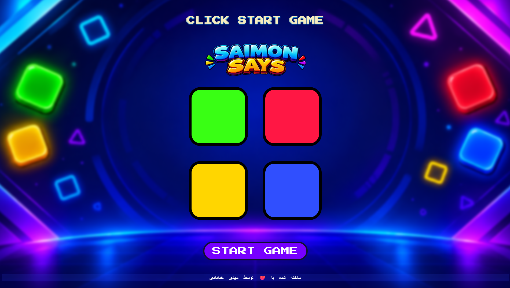

# Simon Says Game 🎮

A fun and interactive memory game built with HTML, CSS, JavaScript, and jQuery.

## Features
- Random color sequences.
- Interactive button animations.
- Sound effects for each color.
- Increasing difficulty with each level.
- Game over and restart functionality.
- Responsive design for different screen sizes.

## Technologies Used
- HTML5
- CSS3
- JavaScript
- jQuery

## How to Play
1. Press the Start button.
2. Watch the color sequence carefully.
3. Repeat the sequence by clicking the colored buttons.
4. Each successful round adds a new color to the sequence.
5. Try to reach the highest level possible!

## Live Demo
[Play the Game](https://mahdi6bit.github.io/SimonSays-Game/)

## Author
Developed with ❤️ by [Mahdi Khodadadi](https://github.com/mahdi6bit)

##ScreenShot

